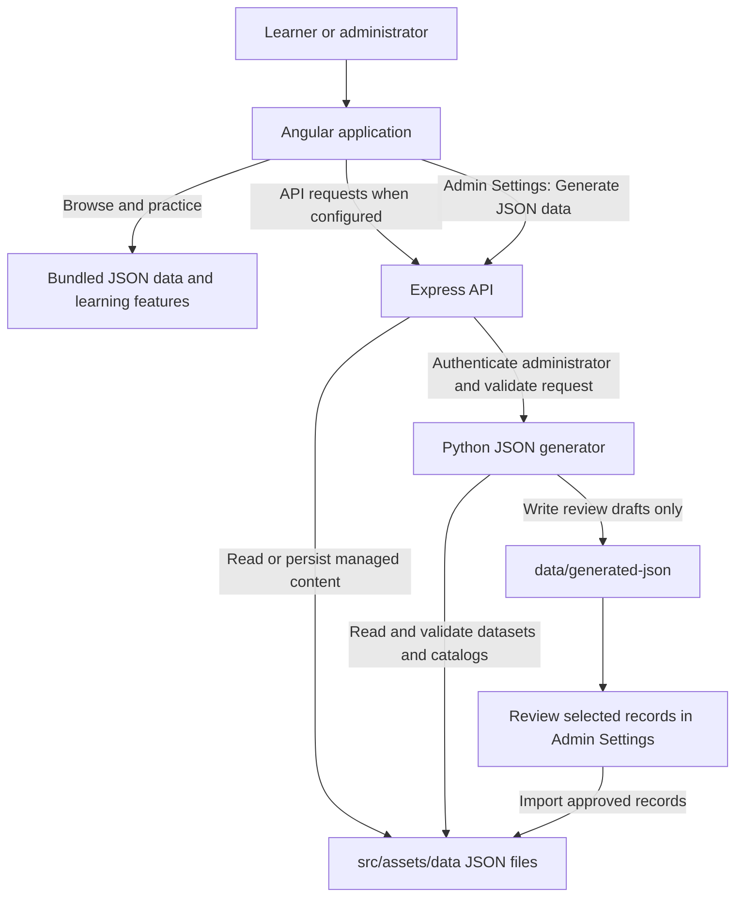

# Angular17JavaTutorial

A comprehensive web-based platform for Java learning and coding practice. This application provides interactive tutorials, code examples, and an online Java compiler for hands-on learning.

**Live Demo**: [https://intelliplanner.github.io/Angular17JavaTotorial/](https://intelliplanner.github.io/Angular17JavaTotorial/)

## Features

- 📚 **Interactive Java Tutorials** - Learn core Java concepts with structured lessons
- 🖥️ **Online Java Compiler** - Write, compile, and run Java code directly in the browser
- 💾 **Save Programs** - Save your Java programs for later access
- 🔧 **Multiple Java Versions** - Support for different Java compiler versions
- 📖 **Interview Questions** - Prepare for technical interviews with curated questions
- 🧭 **Tutorials & Interview Q&A** - Search lessons, filter by topic and difficulty, track reading progress, and save or share content
- 🛠️ **Admin Panel** - Create, edit, publish, and delete tutorials and interview answers with server-side admin authorization
- ⚙️ **JSON Data Generator** - Run the Python dataset generator from the administrator Settings menu
- 🎯 **Code Snippets** - Quick access to common code patterns and examples
- ✨ **Syntax Highlighting** - Beautiful code editor with suggestions

## Topics Covered

- Core Java
- Collections Framework
- Exception Handling
- Java 8 Features (Streams, Lambdas)
- Java 9+ Features
- Design Patterns
- Hibernate & ORM
- Spring Boot
- Microservices
- Kafka
- AWS
- Multithreading

## Tech Stack

- **Frontend**: Angular 17.3.4
- **Styling**: Bootstrap 5.3.3
- **Backend API**: Node.js/Express
- **HTTP Client**: Angular HttpClient

## Application Flow



1. The Angular application opens the requested feature after applying the configured login and route-permission guards.
2. Learners browse tutorials, interview Q&A, video learning, and quizzes. The application uses bundled data and, when configured, the Express API for content.
3. Administrators manage content through protected pages. Successful tutorial and Q&A changes are persisted by the Express API to the source JSON files.
4. For generation, an administrator opens **Settings → Generate JSON data** and selects datasets and minimum record counts. The Angular client sends that request to the protected Express endpoint, which invokes the fixed Python generator module.
5. The generator scans and validates the source datasets against the category catalogs. Validation errors stop generation; otherwise it writes review drafts under `data/generated-json`. It does not modify or publish source content.
6. In the generator page, load a dataset, inspect the draft records, select only approved entries, and choose **Import selected**. Imports are limited to 100 records per action; imported entries are removed from the draft file, and duplicates are rejected. Tutorials are published immediately on import. Q&A is appended to `questions-and-answers.json`. Quiz drafts are routed only to existing category files listed in `question-files.json`; missing subcategories are added to their existing category, while drafts for unmapped categories remain in review.
7. Imported quizzes are stored in the source assets. For a static GitHub Pages deployment, rebuild and redeploy the frontend before learners can load those new quiz questions.

## Prerequisites

- Node.js v20.11.1 or higher
- npm 10.5.2 or higher
- Git

## Installation

```bash
# Clone the repository
git clone https://github.com/intelliplanner/Angular17JavaTotorial.git

# Navigate to project directory
cd Angular17JavaTotorial

# Install dependencies
npm install
```

## Development

### Run Development Server

```bash
npm start
```

Navigate to `http://localhost:4200/`. The application will automatically reload if you change any of the source files.

### Start Backend Server

```bash
npm run server
```

The backend API will run on `http://localhost:9090` (or `http://192.168.1.10:9090` depending on your network configuration).

### Login Access

The `loginEnabled` property in each `src/environments/environment*.ts` file controls route access:

- `true`: users must sign in; route permissions are enforced.
- `false`: all application tabs are available without signing in. The production environment currently sets this to `false`; local development sets it to `true`.

Change `loginEnabled` in `environment.prod.ts` and redeploy to change the GitHub Pages behavior. Disabling frontend login only changes access to application pages; protected backend write/admin APIs continue to require server authentication.

The `settingsEnabled` property in each `src/environments/environment*.ts` file controls whether the administrator Settings menu appears in the header. Set it to `false` to hide the menu or `true` to show it for administrators. This is a navigation visibility option; it does not replace route guards or backend authorization.

When login is enabled on GitHub Pages, username/password login requires the separate Express API:

1. Deploy the Express backend using the repository's `render.yaml` Blueprint. Render generates a `SESSION_SECRET` and enables secure cookies.
2. Set `authApiUrl` in `src/environments/environment.prod.ts` to the deployed backend's HTTPS origin (for example, `https://your-service.onrender.com`, without an `/auth` path).
3. Configure the Render service's `FRONTEND_ORIGINS` variable as `https://intelliplanner.github.io`.
4. Push to `main` or `dev`, or rerun the GitHub Pages workflow.
5. To run locally, start the backend and Angular frontend:

   ```powershell
   $env:SESSION_SECRET = (node -e "process.stdout.write(require('crypto').randomBytes(32).toString('hex'))")
   npm run server
   ```

   The configured local development API is `http://localhost:9090`.

The backend validates the configured accounts in `data/users.json` and issues an HTTP-only session cookie. Keep `SESSION_SECRET` and password hashes on the backend; never put the signing secret in frontend environment files.

The starter accounts are `test` / `test` (learner access) and `admin` / `admin` (full access). Replace these demo credentials before exposing the service publicly.

### Tutorials and Interview Q&A

- Open `/tutorials` to browse published tutorials or use the Interview Q&A tab. Search and filters support all configured categories, topics, and difficulty levels.
- Open `/admin-panel` while signed in as an administrator to manage tutorial drafts/publication and Q&A entries.
- Open **Settings → Generate JSON data** to invoke the server-side Python generator. Select tutorials, Q&A, and/or quiz datasets and set a minimum of 1,000–10,000 output records per selected file. The action requires the authenticated admin session and Node.js API; source data is validated first and never overwritten. Generated review drafts are stored in `data/generated-json` on the server and are not automatically published or merged into the Angular assets.
- The backend requires Python 3.10+; Tkinter is not needed for server execution. On Windows it invokes `py -3`; on other systems it invokes `python3`. Set `PYTHON_EXECUTABLE` to a Python executable path if the runtime is installed elsewhere. The server invokes a fixed Python module and does not accept commands or file paths from the browser.
- Seed content is stored in `src/assets/data/tutorials.json` and `src/assets/data/questions-and-answers.json`. The Express API persists admin changes to those JSON files.
- The production frontend can read the bundled JSON files when no API URL is configured; creating or editing content requires the Express backend and a configured `authApiUrl`.
- Browser bookmarks, tutorial completion, and question votes are stored locally in the current browser.

### Video Learning

- Open `/learn` for a responsive, searchable video library grouped by technology.
- Topic categories and subcategories come from `src/assets/data/topic_categories.json`; video entries are loaded from `src/assets/data/learning-videos.json`.
- YouTube links are restricted to `https://www.youtube.com/@Javatechie` and `https://www.youtube.com/@ApnaCollegeOfficial`. Learners browse those channels directly; the catalog does not embed or link to other videos. Bookmarks and completion progress are kept in browser local storage.
- AI, Claude, Data Science, and Data Engineering paths are included alongside the original technology categories.

The quiz bank includes AI, Claude, Data Science, and Data Engineering question files. Categories and subcategories for the quiz, tutorials, interview Q&A, and video learning are defined in `src/assets/data/topic_categories.json`; interview Q&A entries are stored in `src/assets/data/questions-and-answers.json`.

### Quiz Category Management

- Categories, subcategories, and shared display metadata are stored together in `src/assets/data/topic_categories.json`.
- The app reads this file directly when no backend URL is configured. The Express API exposes `GET /api/categories` and administrator-only `POST`, `PUT`, and `DELETE /api/categories` routes to persist changes to the same file.
- Category and subcategory edits that would orphan existing questions are rejected. Persistent changes require the Express backend and a configured `authApiUrl`.

## Build

### Development Build

```bash
npm run build
```

### Production Build

```bash
npm run build:prod
```

The build artifacts will be stored in the `dist/` directory.

## Testing

### Unit Tests

```bash
npm test
```

Executes the unit tests via [Karma](https://karma-runner.github.io).

## Deployment

### GitHub Pages Deployment

The project is configured to deploy to GitHub Pages using GitHub Actions. On every push to the `main` branch:

1. Dependencies are installed
2. Production build is created with correct base href
3. Build artifacts are deployed to GitHub Pages

**Deployment URL**: `https://intelliplanner.github.io/Angular17JavaTotorial/`

## Project Structure

```
src/
├── app/
│   ├── java-compiler/          # Online Java compiler component
│   ├── interview-questions/    # Interview prep questions
│   ├── java-notes/             # Java tutorials and notes
│   ├── services/               # Angular services
│   ├── dto/                    # Data transfer objects
│   ├── collection/             # Collections framework lessons
│   ├── designpattern/          # Design pattern lessons
│   ├── exception-handling/     # Exception handling lessons
│   └── ... (other feature modules)
├── assets/
│   ├── images/
│   ├── javaNotesPdf/           # PDF resources
│   └── JavaPrograms/           # Sample programs
└── environments/               # Environment configurations
    ├── environment.ts          # Development config
    └── environment.prod.ts     # Production config
```

## Configuration

### Environment Configuration

- **Development** (`environment.ts`): API URL `http://192.168.1.10:9090`
- **Production** (`environment.prod.ts`): the GitHub Pages workflow injects the `AUTH_API_URL` GitHub Actions variable at build time.

## API Endpoints

- `POST /compile` - Compile and execute Java code
- `POST /saveProgram` - Save a Java program
- `GET /getSavedPrograms` - Retrieve saved programs
- `GET /loadProgram?fileName=` - Load a specific program
- `GET /api/tutorials` - List published tutorials
- `GET /api/admin/tutorials` - List all tutorials (admin)
- `POST /api/tutorials` - Create a tutorial (admin)
- `PUT`, `DELETE /api/tutorials/:id` - Update or delete a tutorial (admin)
- `GET /api/questions` - List interview Q&A
- `POST /api/questions` - Create an interview question (admin)
- `PUT`, `DELETE /api/questions/:id` - Update or delete an interview question (admin)

## Contributing

1. Fork the repository
2. Create your feature branch (`git checkout -b feature/AmazingFeature`)
3. Commit your changes (`git commit -m 'Add some AmazingFeature'`)
4. Push to the branch (`git push origin feature/AmazingFeature`)
5. Open a Pull Request

## License

This project is open source and available under the MIT License.

## Support

For issues, questions, or suggestions, please open an issue on the [GitHub repository](https://github.com/intelliplanner/Angular17JavaTotorial/issues).

## Further Help

- [Angular Documentation](https://angular.io)
- [Angular CLI Overview](https://angular.io/cli)
- [Java Documentation](https://docs.oracle.com/javase/)
- [Node.js Documentation](https://nodejs.org/docs/)
